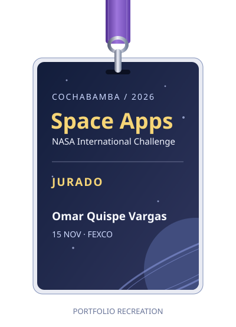

# NASA Space Apps Challenge · Cochabamba 2026

I evaluated projects as a **jury member** on Sunday, **November 15, 2026**, at FEXCO’s Kanata Pavilion in Cochabamba, Bolivia. [Official local event page](https://www.spaceappschallenge.org/2026/local-events/cochabamba/).

The local hackathon took place November 14–15. My role was with the Cochabamba edition.

